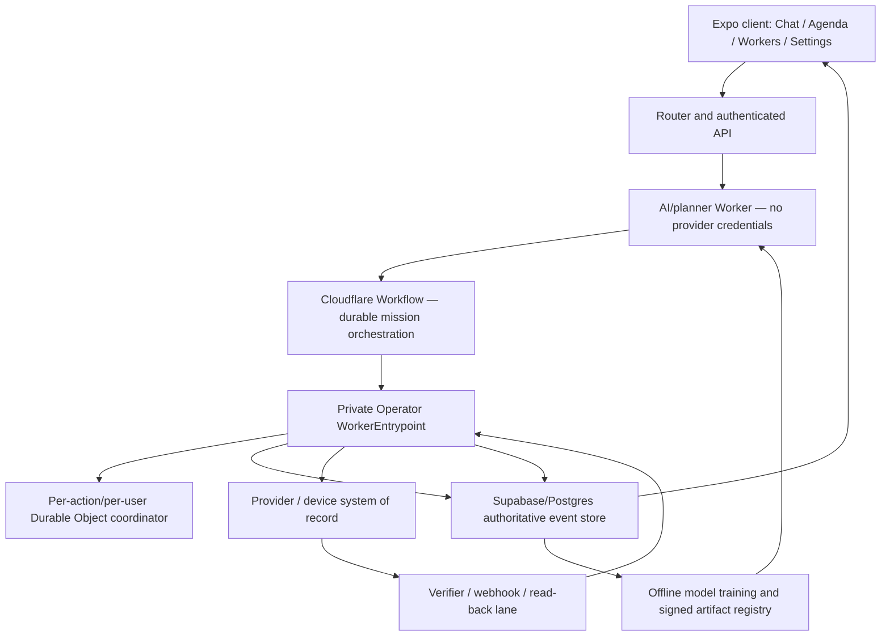
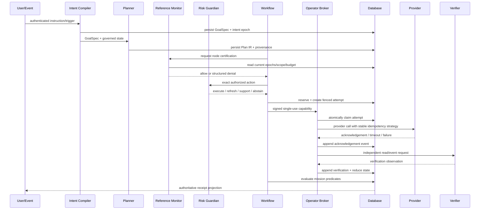

# System Architecture

## 1. Architecture goals

The architecture must provide:

- end-to-end intent integrity;
- one non-bypassable authority and execution chokepoint;
- credential isolation;
- effectively-once provider effects under explicit adapter guarantees;
- durable uncertainty and reconciliation;
- independent effect verification and separate mission-goal evaluation;
- interruptible, revocable, erasable, observable long-running missions;
- model innovation without model authority;
- independently reviewable provider, database, runtime, client, and model evidence.

## 2. Logical topology



## 3. Trust boundaries

### Boundary A — authenticated user intent

Only the authenticated server creates source-message attestations. Client-authored summaries, UI labels, model assertions, and replayed payloads do not count as authorization.

### Boundary B — planner to reference monitor

The planner emits typed candidates and causal dependencies. It cannot send provider credentials or a boolean authorization decision. The reference monitor reconstructs and checks protected fields from the authoritative records.

### Boundary C — reference monitor to broker

An allowed action is represented by a signed, single-use, short-lived capability bound to exact current epochs, Plan IR, action, target, provider, adapter, budget reservation, attempt, and nonce.

### Boundary D — broker to provider

The private Operator Worker resolves credentials only after capability verification and fresh current-state checks. Provider-specific credentials never enter planner context, model traces, GoalSpec, Plan IR, receipts, analytics, or user-visible logs.

### Boundary E — provider to verifier

The verifier uses a separate provider read/event path and records its identity, credential scope, source-of-truth rank, freshness, provider revision, and observed predicates. The executor's own success text is not independent evidence.

### Boundary F — live outcomes to learning

Production outcomes enter an append-only consented ledger. Global models are retrained offline. Model-serving receipts can permit planning influence but never add authority.

## 4. Runtime components

### 4.1 Intent Compiler

Inputs:

- authenticated message or voice transcript;
- authenticated direct UI action;
- current mandate defaults;
- provider-verified exact target candidates;
- schedule/event definition;
- exact approval record.

Outputs:

- frozen GoalSpec;
- protected-slot provenance;
- ambiguity report;
- intent epoch;
- source-message attestation.

### 4.2 Context Assembler

Produces two outputs:

1. **Authoritative mission state:** exact facts and provider objects allowed for the purpose.
2. **Belief projection:** calibrated uncertain features, source freshness, missingness, and OOD indicators.

It performs minimal-purpose projection and never converts inferred context into authority.

### 4.3 Candidate Generator and Planner

Generates a finite set of typed Plan IR candidates. It may use deterministic rules, procedure retrieval, LLM reasoning, temporal models, or world-model simulation. It must provide candidate probabilities when used for policy evaluation.

### 4.4 Reference Monitor

Evaluates:

- authorization source;
- GoalSpec and Plan IR integrity;
- current intent/mandate/consent/connector/kill-switch epochs;
- protected-field provenance;
- capability cell match;
- policy and prohibited-category rules;
- target, account, amount, audience, time, budget, and consequence constraints;
- adapter registration, idempotency class, verifier grade, and recovery semantics;
- temporal trace requirements.

It fails closed and returns a structured, minimally revealing denial.

### 4.5 Runtime Risk Guardian

Veto-only controller over the already authorized exact action. It evaluates current state freshness, action-conditional loss, tail risk, OOD/support, verifier availability, and uncertainty. It can request state refresh, stronger verification, support, authentication, new authority, or abort/compensation.

### 4.6 Private Operator Worker

- no public route;
- invoked through a private service binding/RPC;
- verifies signed capabilities;
- obtains a fenced attempt claim;
- resolves credentials;
- invokes one adapter attempt;
- records provider acknowledgement;
- invokes verification/reconciliation;
- records append-only events and outbox rows;
- never decides user intent or expands policy.

### 4.7 Durable Mission Workflow

Owns:

- waits and schedules;
- dependency sequencing;
- authentication pause/resume;
- bounded replan;
- retries according to action state;
- reconciliation timers;
- compensation ordering;
- mission outcome maturity;
- interruption and supersession.

Every committing provider call is inside a retry-aware Workflow step and remains idempotent under step replay.

### 4.8 Durable Object Coordinators

Use narrowly partitioned coordination atoms such as one logical action or one user/budget partition. They may issue fencing tokens and serialize claims. They do not hold external I/O under a concurrency lock and do not replace Postgres as the authoritative event history.

### 4.9 Authoritative Postgres Store

Stores append-only original facts and deterministic current projections. All other activity/audit/UI streams reference the canonical logical action and event IDs.

### 4.10 Provider Adapters

Each adapter implements:

```text
preflight
canonicalize
execute attempt
observe/read back
verify predicates
reconcile uncertainty
compensate/mitigate
redact receipt
simulate faults
```

## 5. Canonical execution sequence



## 6. Data consistency model

- GoalSpec, Plan IR, mandate versions, events, attempts, verifications, and receipts are durable in Postgres.
- Current-state rows are projections and may be rebuilt.
- External providers are authoritative for their objects and lifecycle states.
- Device state requires signed acknowledgement and system read-back.
- Outbox projections are at-least-once and deduplicated by event ID.
- Provider execution is effectively-once only under the declared adapter strategy.
- UI Realtime updates are convenience projections and never authority.

## 7. Scaling and partitioning

- shard Durable Objects by `owner_user_id:action_id` or another reviewed coordination atom;
- never use one global Durable Object;
- partition high-volume event tables by time only after query evidence requires it;
- index current open actions by user, state, next reconciliation time, provider, and consequence;
- cap model context through minimum-purpose projections and bounded procedure retrieval;
- use queues/Workflows for background projection and evaluation, not the request critical path;
- keep high-consequence authorization and event writes synchronous/fail-closed.

## 8. Availability and degradation

| Failure | Required behavior |
|---|---|
| Planner unavailable | preserve mission; retry planning or use deterministic procedure where certified |
| Risk model unavailable | conservative deterministic policy; high-consequence action abstains |
| Database unavailable before attempt | no provider attempt |
| Database unavailable after possible effect | action becomes/reconciles as uncertain; no blind retry |
| Provider timeout | query system of record before retry |
| Verifier unavailable | retain acknowledgement/uncertain state; do not claim verified |
| Realtime/UI unavailable | work may continue if authority is valid; authoritative receipt appears after reconnect |
| Connector revoked | no new attempt; reconcile already-started effect honestly |
| Device offline | committing device command expires/fails closed |
| Model artifact stale | deterministic fallback; model contributes no influence |

## 9. Observability

Every log/trace includes redacted stable IDs:

```text
request_id
mission_id
run_id
goal_spec_id/version
plan_id/version
action_id
attempt_id
provider
adapter_version
policy_hash
mandate_version
intent_epoch
consent_epoch
connector_epoch
kill_switch_epoch
state
```

Do not log canonical content, credentials, raw health values, authentication data, PAN/CVV, or message bodies by default. High-cardinality IDs belong in structured logs/traces with retention controls, not metrics labels.
