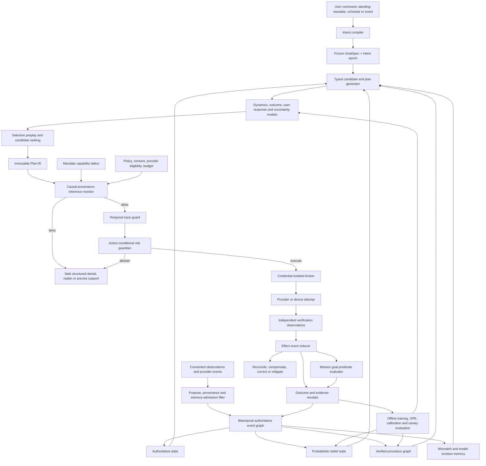

# Agentic Real-Work Operator Kit — Frontier V3 Research-Integrated Amendment

**Date:** 2026-07-16  
**Status:** implementation amendment to the 2026-07-15 Agentic Real-Work Operator Kit completion plan  
**Disposition:** approve the Real Operator direction, but do not implement the plan unchanged  
**Primary objective:** preserve the real-work execution kernel while replacing architecture-by-name with capability-certified world modeling, adding end-to-end intent integrity, action-conditional risk control, origin-bound memory authority, formal trace enforcement, and statistically valid closed-loop policy promotion

---

## 1. Executive decision

The current Operator Kit plan is unusually strong in the areas where most agent systems remain weak:

- a real provider or device mutation is required;
- provider acknowledgement is not treated as verification;
- uncertainty is preserved rather than converted into success;
- authorization is deterministic and server-side;
- credentials are isolated from planners and models;
- revocation, budgets, target matching, reconciliation, compensation, and receipts are first-class;
- shadow behavior is measurement, not a shipped capability;
- promotion is separated by domain, action family, target, and consequence;
- production proof includes provider state, deployed backend state, and installed-client state.

Those principles should remain.

The plan is not yet frontier-complete for seven reasons:

1. It lacks a typed, immutable **intent-to-execution compiler boundary** between natural-language goals and action effects.
2. Its Human Context World Model is still described too much as one model rather than a **factorized authoritative-state, belief-state, procedural, dynamics, outcome, and risk system**.
3. A linear autonomy tier is doing too much work; Operator Kit needs a **capability lattice** plus an action-conditional runtime risk budget.
4. `operator_actions` is described as one state machine, but the durable truth should be **event-sourced**, with separate effect and mission-outcome semantics.
5. Persistent memory has lineage and erasure requirements, but not a strong enough **non-malleable, origin-bound authority model**.
6. Mamba and Dreamer are treated as named milestones. Current research supports a **domain/head-specific architecture tournament** and a much more gradual path from prediction to rank-only control, safe contextual bandits, constrained MPC, and only then Dreamer-style policy learning.
7. Promotion statistics need to distinguish adapter reliability, autonomous decision value, current action risk, delayed outcomes, support overlap, non-stationarity, and user-level personalization. A single personal Beta-Binomial summary is not sufficient.

The resulting system should be framed as a **Human Context Operating Model (HCOM)**. The learned world model is one subsystem inside it, not the authority owner and not the only representation of the user's world.

---

## 2. Research-grounded design principles

### 2.1 Evaluate world-model capabilities, not model names

Operator Kit should classify each world-model component by what it can prove:

- **L0 Registered dynamics:** deterministic contracts, provider state machines, typed procedures, and invariants.
- **L1 Predictor:** calibrated one-step or next-event predictions.
- **L2 Simulator:** decision-usable, action-conditioned multi-step rollouts over a certified horizon.
- **L3 Evolver:** evidence-driven revision after prediction–observation mismatch.

A component is not an L2 simulator merely because it generates plausible future text. It must demonstrate:

1. rollout fidelity;
2. intervention sensitivity;
3. constraint consistency;
4. closed-loop decision utility.

Each action-transition family is certified separately. Calendar creation may reach L2 before social-response prediction. Finance settlement may have a strong deterministic model and a weak user-regret model. Operator Kit should explicitly operate with a **world model in pieces**.

### 2.2 Intelligence and guarantees must have different owners

The planner, LLM, ensemble, procedural model, Mamba-like backbone, or Dreamer-like policy may propose actions and plans. They cannot certify their own feasibility, permission, or risk.

Use separate owners for:

- proposal generation;
- deterministic feasibility;
- provenance and information-flow integrity;
- action-conditional risk and abstention;
- credential resolution;
- provider execution;
- verification;
- mission-outcome evaluation.

### 2.3 Exact authoritative state and lossy latent state must coexist

A recurrent or latent model is a compressed and necessarily lossy representation. It may summarize long histories, but it must never replace exact:

- mandate terms;
- consent purposes;
- recipients;
- accounts;
- provider object IDs;
- budgets;
- external commitments;
- action hashes;
- receipts;
- verification observations;
- unresolved incidents.

Operator Kit should combine an exact authoritative event graph with a learned latent belief state. Long-context recurrence is a performance optimization and predictive representation, not a source of authority.

### 2.4 Live adaptation should be two-speed

During live use:

- append verified episodes;
- record prediction–observation mismatch;
- update bounded per-user posteriors and external procedural/reliability memories;
- quarantine suspicious memory writes;
- keep global neural weights frozen.

Global model updates should happen offline through versioned datasets, replay, leakage and poisoning tests, signed evaluation, canaries, and rollback. This follows a complementary fast-episodic / slow-semantic design and limits catastrophic or adversarial online weight drift.

---

## 3. Revised system architecture



### Six logical planes

1. **Intent plane:** converts natural language into a frozen, inspectable goal contract.
2. **State plane:** maintains exact state, bitemporal observations, beliefs, and memory authority.
3. **Planning plane:** generates typed candidate plans and selective forecasts.
4. **Control plane:** enforces mandate, provenance, temporal policies, and runtime risk.
5. **Execution plane:** resolves credentials, executes, verifies, reconciles, and compensates.
6. **Learning plane:** learns only from consented, mature, authoritative outcomes.

---

## 4. Mandatory new boundary: the Intent Compiler and Goal Lock

A direct user message is not automatically an exact action authorization. The model still interprets the text. Operator Kit needs a compiler-style correctness boundary from the user's words to the canonical effect.

### 4.1 GoalSpec

```ts
export type GoalSpec = {
  goalId: string;
  goalVersion: number;
  intentEpoch: number;

  userId: string;
  conversationId?: string;
  sourceMessageIds: string[];

  objective: string;
  terminalPredicates: GoalPredicate[];
  forbiddenSideEffects: StatePredicate[];

  authoritySlots: {
    actionFamily: BoundSlot<ActionFamily>;
    account: BoundSlot<AccountRef>;
    target: BoundSlot<TargetRef>;
    amount?: BoundSlot<Money>;
    audience?: BoundSlot<AudiencePolicy>;
    timeWindow?: BoundSlot<TimeWindow>;
    consequenceBand: BoundSlot<ConsequenceBand>;
  };

  unresolvedSlots: UnresolvedSlot[];
  mandateId?: string;
  policyHash: string;
  consentEpoch: string;
  validUntil: string;
  canonicalHash: string;
};
```

Each authority-sensitive slot must be bound from one of:

- explicit authenticated user text;
- a unique provider-verified object;
- an exact, current mandate default;
- an exact recorded approval.

A model inference alone cannot fill account, target, recipient, audience, amount, currency, authorization source, cap, purpose, or consequence band.

### 4.2 Intent epochs and interruptions

Every user revision, cancellation, narrowing, replacement, or conflicting instruction increments `intent_epoch`.

Before a plan node starts, the broker verifies:

- `node.intent_epoch == current_intent_epoch`, or
- the node has a new certification proving it is unaffected by the semantic diff.

On interruption:

1. freeze unstarted nodes;
2. let in-flight provider calls reach an honest known/unknown state;
3. compare the new GoalSpec with the old one;
4. retain only unaffected steps;
5. reauthorize changed steps;
6. compensate or mitigate completed steps that now conflict with the revised goal.

This is required for long-running missions. A generic “latest message wins” prompt rule is not sufficient.

### 4.3 Denial feedback must have two channels

```ts
type DenialResult = {
  plannerCode:
    | "missing_high_integrity_target"
    | "outside_mandate"
    | "stale_state"
    | "risk_abstention"
    | "authentication_required"
    | "verifier_unavailable";

  plannerSafeDetail?: string;
  authenticatedUserExplanation: string;
  internalPolicyTraceRef: string;
};
```

The planner receives the minimum safe information needed to continue. The authenticated user can receive a richer explanation. Internal policy thresholds, protected facts, and denial-derived signals must not be exposed to untrusted content or later laundered through a benign action.

---

## 5. Immutable typed Plan IR and causal provenance

### 5.1 Plan IR

```ts
export type PlanIR = {
  planId: string;
  planVersion: number;
  goalSpecHash: string;
  intentEpoch: number;
  mandateVersion: number;
  policyHash: string;
  consentEpoch: string;
  provenanceRootHash: string;
  expiresAt: string;

  nodes: PlanNode[];
  edges: PlanEdge[];
  missionRiskBudget: RiskBudget;
  terminalPredicates: GoalPredicate[];
};

export type PlanNode = {
  nodeId: string;
  action: CanonicalOperatorAction;
  protectedInputBindings: ProtectedInputBinding[];
  preconditions: StatePredicate[];
  expectedPostconditions: StatePredicate[];

  consequence: ConsequenceVector;
  idempotencyClass: IdempotencyClass;
  verificationRef: string;
  compensationRef?: string;
  pointOfNoReturn?: PointOfNoReturn;

  maxAttempts: number;
  safeRetryPolicy: SafeRetryPolicy;
  uncertaintyPolicy: UncertaintyPolicy;
};
```

The Plan IR is immutable after authorization. Replanning creates a new plan version and invalidates capabilities minted for changed nodes.

### 5.2 Causal provenance graph

A linear message log is insufficient. Store typed dependency edges among:

- user messages;
- provider observations;
- memory items;
- summaries;
- model outputs;
- tool results;
- denials;
- plan nodes;
- actions;
- verifications;
- compensations.

Every proposed protected field must have a backward dependency slice that satisfies the information-flow policy.

### 5.3 Provenance labels

```ts
type ProvenanceLabel = {
  origin:
    | "authenticated_user"
    | "provider_system_of_record"
    | "trusted_system"
    | "model_derived"
    | "external_untrusted";

  integrity: "high" | "medium" | "low" | "untrusted";
  sensitivity: SensitivityClass;
  purposes: PurposeId[];

  occurredAt?: string;
  observedAt: string;
  ingestedAt: string;

  originRef: string;
  transformationRefs: string[];
  authorityCeiling: MemoryAuthority;
};
```

### 5.4 Protected-field rule

For every protected action field:

```text
integrity(field) >= required_integrity(field)
AND purpose(field) includes action purpose
AND origin authority was not elevated by summarization, trusted-tool echo,
manufactured corroboration, model consensus, or denial feedback
```

The following fields are protected by default:

- action family;
- account;
- target or recipient;
- merchant;
- amount and currency;
- audience;
- shipping address;
- device;
- authorization source;
- consent purpose;
- cap;
- point of no return.

External content may fill only registry-approved bounded content slots, such as a message body or search query, after deterministic validation.

---

## 6. Capability lattice, not authorization by tier alone

Keep A0–A5 as understandable product labels, but do not make a scalar tier the actual authority primitive.

### 6.1 Capability cell

```ts
type CapabilityCell = {
  userId: string;
  mandateId: string;

  domain: Domain;
  actionFamily: ActionFamily;
  provider: ProviderId;
  account: AccountRef;

  targetClass: TargetClass;
  targetRule: TargetPolicy;
  purpose: PurposeId;

  consequence: ConsequenceVector;
  amountBand?: MoneyBand;
  audience?: AudiencePolicy;

  reversibility: ReversibilityClass;
  minimumVerificationGrade: VerificationGrade;
  idempotencyClasses: IdempotencyClass[];

  timePolicy: TimePolicy;
  evidenceEpoch: string;
  maximumProductTier: AutonomyTier;
};
```

Authorization is the intersection of the exact action with one cell. Calendar evidence does not transfer to email. Private calendar evidence does not transfer to attendee invitations. A small repeat purchase does not transfer to travel, public posts, file deletion, or legal forms.

### 6.2 Maximum-autonomy envelope

At enrollment, the user defines the maximum categories Operator Kit may ever earn automatically.

Recommended behavior:

- A2 low-propagation reversible work may be enabled by default after self-test.
- A3 categories may be included in the disclosed enrollment envelope.
- A4 and A5 categories require a one-time explicit category and consequence-band inclusion.
- After inclusion, promotion and re-promotion may be automatic without repeated per-action or per-promotion taps.
- Promotion can never add a category, target, purpose, audience, or cap.

This preserves the one-mandate product while preventing a general enrollment from silently evolving into health, financial, public, legal, destructive, or other high-consequence authority.

### 6.3 A2 must be narrowed

“Compensable” is not the same as reversible.

A2 should require:

- bounded private scope;
- no external human notification or public propagation;
- low maximum harm;
- verified pre-state;
- a tested compensator;
- no material residual effect after compensation.

For example:

- creating a private focus block may qualify;
- inviting external attendees does not, because notifications and social effects can persist after deletion.

---

## 7. Add an action-conditional runtime risk guardian

Historical evidence defines the maximum eligible capability. It does not make every current action safe.

### 7.1 Decision rule

For candidate action \(a\) in belief state \(b_t\):

\[
\text{execute}(a)
\iff
G(a)=\text{allow}
\land
\widehat{Q}_{1-\delta}(L \mid b_t,a) \le \epsilon_{\text{cell}}
\land
\text{OOD}(b_t,a) \le \tau
\land
V(a) \ge V_{\min}
\]

where:

- \(G(a)\) is the deterministic mandate/policy/provenance gate;
- \(\widehat{Q}\) is an action-conditional upper risk or tail-loss bound;
- \(\epsilon_{\text{cell}}\) is the user/organization risk budget for the exact capability cell;
- `OOD` measures support and distribution shift;
- \(V(a)\) is available verifier strength.

The guardian is veto-only. It cannot convert a denied action into an allowed action.

### 7.2 Consequence vector

```ts
type ConsequenceVector = {
  financialMaxLoss?: Money;
  privacySeverity: 0 | 1 | 2 | 3 | 4;
  publicReach: "private" | "bounded_group" | "organization" | "public";
  legalFinality: 0 | 1 | 2 | 3 | 4;
  healthImpact: 0 | 1 | 2 | 3 | 4;
  physicalImpact: 0 | 1 | 2 | 3 | 4;
  accountSecurityImpact: 0 | 1 | 2 | 3 | 4;
  propagation: "single_object" | "multiple_objects" | "external_people" | "public";
  reversibility: "full" | "partial" | "time_limited" | "none";
};
```

### 7.3 Support controller

When Operator Kit abstains, choose the least burdensome support likely to resolve the uncertainty:

1. re-read provider state;
2. wait for propagation;
3. invoke a stronger verifier;
4. fetch a missing authoritative fact;
5. ask one non-authority clarification;
6. request authentication;
7. request exact new authority;
8. abort, compensate, or mitigate.

Track:

- unnecessary support;
- missed support;
- false intervention;
- missed beneficial intervention;
- wrong action;
- wrong timing;
- wrong target.

Do not collapse these into one regret variable.

---

## 8. Truthful distributed execution semantics

### 8.1 Replace universal “exactly once”

Across arbitrary third-party providers, Operator Kit cannot universally guarantee physical exactly-once execution. The truthful contract is:

> One logical action produces at most one accepted external effect under its registered idempotency and reconciliation strategy. If the provider cannot safely prevent or detect duplication, Operator Kit does not retry unattended and retains the action as uncertain.

### 8.2 Idempotency classes

```ts
type IdempotencyClass =
  | "provider_native_key"
  | "client_generated_object_id"
  | "compare_and_swap_version"
  | "read_before_retry"
  | "single_attempt_reconcile_only"
  | "non_idempotent_unattended_forbidden";
```

Every adapter must declare:

- provider idempotency behavior;
- duplicate-detection method;
- safe retry rule;
- stale-read behavior;
- propagation delay;
- maturity horizon;
- point of no return.

### 8.3 Single authority store

For the current stack:

- Postgres `operator_action_events` should be the durable authoritative state.
- Durable Objects may serialize claims, maintain leases, or coordinate a user/action-family partition.
- Workflows orchestrate retries and waiting.
- Neither a Durable Object nor a Workflow checkpoint may independently assert a terminal action result that conflicts with the event ledger.

Do not hold a Durable Object transaction or concurrency lock across external provider I/O. Reserve atomically, release the local transaction, perform the provider call, then finalize through a fenced compare-and-swap.

### 8.4 Fencing and epochs

Every provider attempt binds:

- action ID;
- attempt ID;
- current fencing epoch;
- intent epoch;
- mandate version;
- policy hash;
- consent epoch;
- connector epoch;
- kill-switch epoch;
- plan hash;
- action hash;
- provider adapter version;
- idempotency key.

A late worker with an obsolete epoch may record diagnostics, but it cannot begin a new effect or finalize terminal state.

---

## 9. Event-sourced effect lifecycle and separate mission outcome

### 9.1 Tables

```text
operator_actions
operator_action_events
operator_attempts
operator_verification_observations
operator_compensation_attempts
operator_action_dependencies
operator_mission_outcomes
operator_action_current
operator_outbox
```

`operator_action_current` is a deterministic projection, not the original history.

### 9.2 Effect state

```text
planned
→ authorized
→ reserved
→ executing
→ provider_acknowledged
→ verified | permanent_verified | uncertain | failed
→ reconciling
→ compensating
→ compensated | compensation_failed
```

Additional explicit states should include:

```text
expired
superseded
aborted
awaiting_authentication
precondition_failed
risk_abstained
```

### 9.3 Mission outcome state

```text
open
→ evaluating
→ goal_satisfied
 | partially_satisfied
 | goal_failed
 | goal_uncertain
 | superseded
```

A verified effect is not automatically a satisfied mission.

Examples:

- a calendar event can be created correctly but violate a conflict predicate;
- an email can exist in Sent but not satisfy a delivery-dependent goal;
- a ride can be requested but arrive too late;
- an order can be accepted but fulfilled with a disallowed substitution.

Mission satisfaction requires the GoalSpec terminal predicates to mature and pass.

---

## 10. Verification grades and compensation taxonomy

### 10.1 Verification grades

| Grade | Evidence | Typical eligibility |
|---|---|---|
| V0 | no independent verifier | never autonomous |
| V1 | write response only | fixture/development |
| V2 | separate provider GET/list or independently refreshed system-of-record view | low-consequence A2/A3 |
| V3 | separate read-back plus provider event/webhook/state transition | preferred A3/A4 and many A5 effects |
| V4 | cross-source corroboration, device attestation, settlement, or another independent outcome source | highest consequence |

Every verifier declares:

- source of truth;
- verifier implementation identity;
- credential scope;
- expected predicates;
- stale-read detection;
- expected propagation delay;
- maturity horizon;
- source precedence;
- learned-judge role.

A learned judge, VLM, DOM judge, screenshot score, toast, or the executor's own trace may support verification but cannot be the sole A3–A5 verifier.

### 10.2 Compensation types

Do not use “undo” as the universal label.

```ts
type RecoverySemantics =
  | "true_reversal"
  | "time_limited_cancellation"
  | "restoration"
  | "refund_initiated"
  | "refund_settled"
  | "correction"
  | "mitigation"
  | "partial_reversal"
  | "irreversible";
```

Examples:

- cancelling a queued email is reversal;
- a sent email can only be corrected or followed up;
- deleting a public post does not reverse screenshots, indexing, or notifications;
- initiating a refund is not the same as settlement;
- restoring a file does not reverse prior disclosure.

The UI must display the correct semantics.

---

## 11. Poisoning-resistant memory authority

### 11.1 Memory classes

```text
authoritative_user_facts
authoritative_provider_facts
immutable_episodic_ledger
derived_hypotheses
procedural_memory
run_local_working_memory
quarantine
```

### 11.2 Non-malleable origin authority

A memory's authority is bound at write time to its origin and cannot be elevated by:

- model summarization;
- a trusted tool echoing the same untrusted claim;
- multiple attacker-controlled sources repeating it;
- compression;
- procedure induction;
- agent consensus.

Core invariant:

```text
authority(transform(x)) <= authority(origin(x))
```

An elevation requires a separate receipt backed by independent, policy-approved corroboration or explicit authenticated user confirmation.

### 11.3 Memory write receipt

```ts
type MemoryWriteReceipt = {
  memoryId: string;
  memoryClass: MemoryClass;

  originRefs: string[];
  immutableOriginAuthorities: OriginAuthority[];
  contentHash: string;
  transformationRefs: string[];

  authorityCeiling:
    | "none"
    | "display_only"
    | "preference_ranking"
    | "planning_only"
    | "authoritative_fact";

  purposes: PurposeId[];
  consentEpoch: string;
  expiresAt?: string;

  contradictionState: "none" | "open" | "resolved";
  corroborationRefs: string[];
  elevationReceiptRef?: string;

  writerIdentity: string;
  modelArtifactId?: string;
  policyHash: string;
};
```

### 11.4 Memory rules

- external content never directly becomes authoritative memory;
- compaction is a new memory write and must preserve immutable origin labels;
- user-attested and provider-verified facts outrank inferred summaries;
- model-derived memory cannot select account, recipient, target, amount, audience, authorization source, cap, consent purpose, or credential path;
- procedure induction requires multiple verified outcomes and negative evidence;
- contradictions remain explicit until resolved;
- erasure traverses summaries, embeddings, graph edges, procedures, datasets, and derived artifacts;
- live outcomes do not directly update global model weights.

---

## 12. Human Context Operating Model

### 12.1 Factorized state

Operator Kit should maintain:

1. **Authoritative state \(x_t\):** exact provider/user/system facts.
2. **Latent state \(z_t\):** uncertain routine, task progress, interruptibility, preference stability, and hidden context.
3. **Observation model:** whether a source is connected, delayed, stale, missing, or denied.
4. **Action-conditioned transition model:** expected change after an Operator Kit or external action.
5. **Human-response model:** acceptance, regret, correction, interruption cost.
6. **Mission-outcome model:** probability and timing of goal satisfaction.
7. **Risk model:** loss distribution and OOD support.
8. **Procedure model:** reusable typed workflows and reliability.

A belief state is:

\[
b_t = p(x_t,z_t \mid o_{\le t},a_{<t},\text{source availability},\text{consent})
\]

The planner selects only among deterministically feasible plans:

\[
P^* =
\arg\max_{P \in \mathcal{F}(M,C,G)}
\mathbb{E}[U_{\text{goal}}(P)\mid b_t]
-\lambda_I C_{\text{interruption}}(P)
-\lambda_E C_{\text{execution}}(P)
-\rho \operatorname{CVaR}_{\alpha}(L(P)\mid b_t)
\]

### 12.2 Bitemporal observations

Every assertion/event supports:

```text
occurred_at
observed_at
ingested_at
valid_from
valid_to
revision
supersedes
source_latency
freshness_ttl
missingness_code
```

Missingness codes include:

```text
not_observed
permission_denied
device_offline
provider_unavailable
not_applicable
source_not_connected
observation_delayed
```

Missing data is not negative evidence that an event did not occur.

### 12.3 Event segmentation

Use separate prediction-error and prediction-uncertainty signals to create episodic boundaries:

- high prediction error: the world behaved differently from the model;
- high prediction uncertainty: the model lacked a precise expectation.

These signals should remain distinct. They can trigger:

- a new episode boundary;
- belief reset or increased uncertainty;
- provider-state refresh;
- procedural mismatch review;
- selective re-planning;
- offline training-data prioritization.

They do not create authority.

### 12.4 Procedural world model

Maintain a typed procedure graph:

```text
procedure
→ preconditions
→ action transition
→ expected observations
→ failure branches
→ verifier
→ compensator
→ reliability record
```

Preplay retrieves a small number of verified procedure paths. After execution, prediction–observation mismatches update reliability and propose new procedure candidates. New procedures remain quarantined until type-checked, verified in a test account, and admitted by policy.

### 12.5 Selective foresight

World-model outputs enter planning only when:

- the action/context is inside support;
- the predicted horizon is inside the calibrated horizon;
- uncertainty is below the domain threshold;
- constraint checks pass;
- the prediction is not sourced from quarantined or low-authority memory.

A weak forecast should be omitted rather than shown to the planner as persuasive fiction.

---

## 13. Temporal and long-context model tournament

Do not pre-commit to Transformer-Mamba as the final backbone. Run a champion/challenger tournament per domain and prediction head.

### 13.1 Candidate families

| Family | Candidate use |
|---|---|
| deterministic rhythm and calendar logic | schedules, hard constraints, baseline |
| Hawkes / marked temporal point process | event intensity, next event and time |
| BOCPD | routine and provider regime shifts |
| boosted trees | sparse tabular context and interruptibility |
| survival / competing risks | time to delivery, cancellation, settlement, regret |
| Neural CDE / CRU | irregular continuous-time observations |
| EventFlow-like joint event models | multi-event future distributions |
| Transformer | moderate-context cross-channel interaction |
| Mamba-3 | efficient recurrent long-history representation |
| Gated DeltaNet-2 | long-context recurrent retrieval/editing challenger |
| Kimi/KDA-style hybrid | linear recurrence plus bounded attention |
| HOLA/Titans/ATLAS-style memory | compressed state plus exact recent retrieval |
| graph-temporal network | people, projects, places, commitments and devices |
| JEPA/next-embedding latent model | action-conditioned latent prediction without reconstructing every raw observation |
| procedure graph + LLM | abstract workflow dynamics and failure recovery |

The winner may differ by output head. A tree model may win interruptibility; a TPP may win next-event timing; a graph model may win project dependencies; a recurrent hybrid may win long-history representation.

### 13.2 Data-readiness gate

The current `5,000 events / 50 users` floor is useful for validating:

- exporters;
- consent filtering;
- split correctness;
- baseline training;
- calibration code;
- artifact signing.

It is not sufficient proof that a custom long-context world model or offline-RL policy is warranted.

Every training decision needs a signed data-readiness report:

- action-conditioned transition count;
- mature outcome count;
- effective sample size after clustering;
- per-provider/action/target/consequence coverage;
- support overlap;
- missingness and censoring;
- scaling curves;
- leakage and consent audit;
- privacy budget;
- class imbalance and rare-event coverage.

### 13.3 Training objectives

Recommended multitask objectives:

- next event type;
- time to event;
- next authoritative state delta;
- observation availability and latency;
- action-conditioned next-state embedding;
- provider verification mismatch;
- mission goal outcome;
- regret/correction/undo;
- interruption cost;
- change point;
- epistemic and aleatoric uncertainty;
- abstention/support value.

Self-supervised objectives may include:

- masked channel/value reconstruction;
- time-gap prediction;
- order corruption;
- next-event contrast;
- cross-window consistency;
- masked procedure step;
- next-state embedding prediction.

Do not reconstruct prohibited raw health or private content merely to improve representation learning.

---

## 14. Re-stage Dreamer and policy learning

Dreamer-style imagination should be a late-stage challenger, not the assumed destination.

### Stage 0 — deterministic champion

Rules, schedules, provider state machines, conflict checks, typed procedure graphs, and simple ranking perform real work.

### Stage 1 — L1 supervised predictors

Predict next state/event/time, goal outcome, verification mismatch, regret, and uncertainty. No learned action selection.

### Stage 2 — procedural preplay

Retrieve verified procedure paths and failure/compensation branches.

### Stage 3 — finite candidate ranker

The learned model ranks a finite candidate set already inside the mandate and policy envelope. It cannot invent an unregistered effect.

### Stage 4 — safe contextual bandit

Randomize only among comparable, low-risk, already authorized alternatives. Log:

- full candidate set;
- selection probabilities;
- abstention probability;
- support probability;
- context and model versions;
- mature outcome.

### Stage 5 — constrained receding-horizon MPC

Simulate a short typed plan, execute one action, independently read back state, update belief, and replan. Do not execute an open-loop imagined multi-action sequence.

### Stage 6 — Dreamer-style latent policy challenger

Advance only when Operator Kit has:

- adequate action-conditioned trajectories;
- stable reward and goal definitions;
- mature delayed outcomes;
- sufficient support overlap;
- validated provider/world twins;
- strong uncertainty and shift detection;
- recovery data;
- no evidence of reward hacking.

The policy emits a Plan IR. It has no credentials, permission, or second executor.

---

## 15. Promotion and policy evaluation V3

### 15.1 Four conjunctive evidence layers

#### Layer 1 — hard invariants

Immediate demotion for:

- unauthorized effect;
- wrong target or protected argument;
- cap, purpose, or consent violation;
- duplicate effect;
- verifier false positive;
- credential leakage;
- prohibited category;
- public-audience mismatch;
- material loss outside policy.

These are non-averageable.

#### Layer 2 — effect reliability

Estimate by:

```text
provider
× adapter version
× action contract
× verifier grade
× consequence band
× amount band
```

Measure verified completion, unresolved outcome, duplicate prevention, recovery, compensation, and maturity latency.

#### Layer 3 — autonomous decision value

Measure separately:

- false act;
- missed beneficial act;
- wrong timing;
- regret;
- correction;
- interruption burden;
- missed support;
- verified goal utility.

#### Layer 4 — current runtime risk

Every action still passes the current risk, OOD, freshness, and verifier-availability checks.

### 15.2 Replace the single personal Beta-Binomial decision model

A Beta-Binomial may remain a transparent baseline for simple adapter success/failure. For personalized autonomous decisions, use a versioned hierarchical dynamic model with:

- user random effects;
- provider and action-contract effects;
- target and consequence-band effects;
- context-regime features;
- time decay;
- change-point epochs;
- delayed outcome survival/censoring;
- explicit selection propensities.

Do not combine false intervention and regret into one outcome.

### 15.3 OPE requirements

For policy promotion:

- log the complete eligible candidate set;
- log exact known propensities;
- require minimum support overlap;
- report effective sample size;
- cap importance weights;
- use a doubly robust estimator when assumptions are satisfied;
- maintain anytime-valid confidence sequences/e-processes for repeated monitoring;
- refuse promotion in unsupported strata.

A model-generated counterfactual is not identified evidence merely because it is plausible.

### 15.4 Threshold revisions

Keep the current live exposure floors as operational minima, but make all of the following conjunctive:

1. raw exposure floor;
2. effective sample-size floor;
3. critical-stratum coverage;
4. anytime-valid error/risk bounds;
5. no hard invariant failures;
6. current version compatibility;
7. runtime action-conditional calibration;
8. live canary proof.

Remove global constraints such as `abstention <= 0.75` and `pairwise error correlation <= 0.90` as universal release rules. Replace them with:

- risk–coverage frontier;
- incremental ensemble value;
- oracle ensemble gap;
- utility at fixed risk;
- latency/energy/cost budget;
- calibration by critical stratum.

### 15.5 Incident re-earning

The fixed 30-day/20-clean-action floor may remain as a minimum, but severe incidents additionally require:

- root-cause classification;
- affected capability-cell invalidation;
- exploit/regression fixture;
- formal or property-level repair evidence;
- provider/version compatibility review;
- independent incident closure;
- a new evidence epoch.

Do not automatically restore evidence unrelated to the root cause unless the compatibility graph proves it remains valid.

---

## 16. Domain-specific corrections

### 16.1 Calendar

Split action contracts:

- `calendar.private_event.create/update/delete`;
- `calendar.attendee_event.create/update/cancel`.

Attendee actions are external communication and do not qualify as fully reversible A2 work.

Bind:

- calendar ID;
- event ID;
- provider revision/ETag;
- timezone;
- attendee set;
- notification mode;
- conflict predicate;
- organizer identity.

Deleting or cancelling an invitation is compensation, not proof that notifications and social effects were undone.

### 16.2 Email and messaging

Separate:

```text
queued
provider_accepted
sent_object_verified
delivered
bounced
corrected
```

A queued send may be cancelled. A sent message is irreversible. A provider Sent-folder object can verify sending, but not necessarily recipient delivery.

The GoalSpec must state whether the goal is:

- create a sent object;
- deliver without bounce;
- obtain a reply;
- communicate before a deadline.

### 16.3 Browser

Before a committing browser step:

- freeze the exact commit action graph;
- bind host, account, object, field values, and submit consequence;
- refresh page/account identity;
- detect stale UI state;
- prevent untrusted page content from changing protected fields;
- require system-of-record verification.

A DOM toast, screenshot, or automation trace is supporting evidence only.

### 16.4 Device and health

Use a device-held signing key and app/device attestation for committing acknowledgements. Re-evaluate mandate, consent, connector, and kill-switch state under a short online lease immediately before execution.

Medication schedules must be explicitly user-defined or provider-verified. Operator Kit may not infer or alter medication instructions.

Raw health values remain local. Cloud training should use only separately consented, purpose-bounded features. Federated or differentially private learning is an optional later capability, not a reason to weaken the local-only rule.

### 16.5 Smart home

Add a physical-safety envelope:

- device capability;
- occupancy assumptions;
- safe state;
- maximum actuation range;
- emergency override;
- rollback;
- sensor freshness.

Locks, garage doors, alarms, heating extremes, appliances with fire risk, and access-control systems require separate high-consequence capability cells rather than inheriting ordinary device-control evidence.

### 16.6 Ride

Model the full ride state:

```text
quote
requested
matched
driver_assigned
arriving
picked_up
completed
cancelled
fee_settled
```

A request receipt is not a successful commute. Live canaries should be geo-fenced, staff-only, capped, and exclude vulnerable passengers.

### 16.7 Commerce and finance

Keep authorization, capture, order, fulfillment, substitution, settlement, refund, and chargeback separate.

A5 policy must include:

- expected loss;
- high-quantile/CVaR tail loss;
- price and item drift;
- merchant and address identity;
- cancellation boundary;
- residual liability;
- provider and payment-network eligibility.

### 16.8 Public, destructive and legal/form work

Deleting a public post is mitigation, not true reversal.

Destructive work requires:

- pre-state snapshot;
- exact object version;
- referential-impact analysis;
- point of no return;
- restore or mitigation semantics.

Legal/form submission may become autonomous only as a clerical execution of user-attested content. Operator Kit must not autonomously make legal representations, attest facts it cannot verify, or replace licensed professional judgment.

### 16.9 Teach the Operator

Use:

```text
demonstration
→ procedure candidate
→ typed Plan IR
→ protected-field and target extraction
→ verifier discovery
→ static/formal checks
→ sandbox replay
→ directed real run
→ evidence accumulation
→ capability promotion
```

A demonstration never becomes an unbounded macro or credential-bearing replay.

---

## 17. Exact task-plan amendments

### Add Task 0A — Intent compiler, Plan IR and causal reference monitor

**Create:**

```text
src/lib/operator/goal-spec.ts
src/lib/operator/intent-compiler.server.ts
src/lib/operator/intent-epoch.ts
src/lib/operator/plan-ir.ts
src/lib/operator/provenance.ts
src/lib/operator/information-flow.ts
src/lib/operator/reference-monitor.ts
src/lib/operator/trace-policy.ts
src/lib/operator/denial-result.ts
docs/operator/intent-to-execution-integrity.md
```

**Add migration:**

```text
supabase/migrations/20260715125000_operator_plan_ir.sql
```

**Acceptance:**

- every committing action belongs to an immutable Plan IR;
- protected fields have valid backward provenance slices;
- plan mutation invalidates the capability;
- a user interruption increments the intent epoch;
- denied actions become provenance events;
- untrusted content cannot alter protected fields.

### Amend Task 0

Add to each action contract:

```text
idempotency_class
verification_grade
goal_predicate_template
source_of_truth_rank
expected_propagation_delay
maturity_horizon
point_of_no_return
safe_retry_policy
risk_feature_schema
formal_trace_invariants
```

### Amend Task 1

Replace mutable lifecycle shortcuts with append-only action events and attempts.

Add tests for:

- stale intent epoch;
- superseded plan;
- late worker with stale fence;
- non-idempotent uncertain action;
- verified effect but failed mission predicate;
- denial-feedback leakage.

### Amend Task 2

Add:

```text
maximum_autonomy_envelope
capability_cells
risk_budgets
minimum_verification_grade
allowed_idempotency_classes
provider/legal eligibility
support_preferences
```

A4/A5 automatic promotion applies only to explicitly included envelope categories.

### Amend Task 3

Bind broker capability to:

```text
GoalSpec hash
Plan IR hash
provenance root
intent epoch
mandate version
policy hash
consent epoch
connector epoch
kill-switch epoch
fencing token
attempt ID
adapter version
not-before and expiry
```

Use a private Service Binding, but keep the signed capability and caller/audience checks. Internal network isolation is not the authorization proof.

### Amend Task 4

Add:

```text
operator_action_events
operator_attempts
operator_verification_observations
operator_mission_outcomes
memory_write_receipts
memory_influence_receipts
decision_opportunities
support_decisions
world_model_mismatches
```

Add bitemporal fields and origin-bound authority labels.

### Amend Task 5

Calendar kernel exit must prove both:

1. provider effect verification;
2. mission goal-predicate satisfaction.

Use a private event for the A2 kernel test and a separate attendee canary for A3.

### Amend Tasks 6–10

Every adapter must implement:

```text
effect contract
provider state machine
idempotency strategy
precondition snapshot
verification observations
mission predicates
uncertainty horizon
compensation/mitigation semantics
provider fault simulator
version-compatibility receipt
```

### Amend Task 11

Replace “world-state assembler” with:

```text
authoritative state assembler
bitemporal observation process
belief-state estimator
minimal-purpose projection
event-boundary detector
memory authority filter
```

### Replace Task 12 with four packages

#### 12A — data readiness and deterministic/statistical champions

Rhythm, calendar logic, Hawkes/TPP, survival, trees, BOCPD, calibration.

#### 12B — temporal backbone tournament

Neural CDE/CRU, EventFlow-like models, Transformer, Mamba-3, Gated DeltaNet-2, Kimi/KDA hybrids, HOLA/Titans/ATLAS-style memory, graph-temporal models.

#### 12C — procedural world model and selective foresight

Procedure graph, reliability records, preplay, mismatch updates, quarantine.

#### 12D — action-conditioned dynamics, outcome and risk models

Next state, observation latency, verification mismatch, mission outcome, regret, OOD, tail risk.

### Replace Task 13 with five packages

#### 13A — finite candidate ranker

#### 13B — safe contextual-bandit canary

#### 13C — constrained receding-horizon MPC

#### 13D — Dreamer-style latent challenger

#### 13E — certified prefix execution

Accept only the longest plan prefix that passes current hard feasibility and calibrated value/risk boundaries. Re-certify after each material observation.

### Amend Task 14

Add UI for:

- GoalSpec and intent changes;
- effect state versus mission outcome;
- source freshness;
- which context classes influenced a plan;
- current risk abstention/support reason;
- verification grade;
- true recovery semantics;
- capability-cell scope;
- maximum envelope versus earned current capability.

### Amend Task 15

Add production qualification suites:

- TLA+/PlusCal or equivalent lifecycle, budget, revocation, saga, and fencing models;
- causal information-flow and denial-laundering tests;
- AgentDojo/CaMeL-style prompt-injection cases;
- memory-poisoning and sleeper-memory cases;
- long-horizon and interruption cases;
- provider fault injection;
- stale verifier and correlated verifier failures;
- reward hacking and unsupported counterfactuals;
- harness-version regressions;
- user-comprehension tests for A4/A5 enrollment and permanent effects.

---

## 18. Formal specifications to add

```text
specs/operator/ActionLifecycle.tla
specs/operator/BudgetReservation.tla
specs/operator/RevocationEpoch.tla
specs/operator/SagaCompensation.tla
specs/operator/FencingAndRetry.tla
specs/operator/IntentInterruption.tla
specs/operator/CapabilityLattice.tla
```

Properties:

1. no provider attempt begins without current authorization and reservation;
2. no stale epoch can commit;
3. one logical action has at most one accepted effect under its adapter strategy;
4. money cannot be double-reserved or double-committed;
5. revocation prevents all new attempts;
6. an irreversible step cannot begin before all required reversible preconditions are verified;
7. compensation cannot be reported as complete before its verifier passes;
8. a superseded intent cannot start a conflicting node;
9. all terminal projections are derivable from append-only events;
10. no denied action can be reintroduced through a second authority path.

---

## 19. Provider fault matrix

Every adapter must test:

```text
timeout before provider commit
timeout after provider commit
2xx with delayed visibility
stale GET/list result
duplicate webhook
out-of-order webhook
provider retries the request
409/412 version conflict
partial update
credential revoked during execution
OAuth scope reduction
rate limit
provider outage
provider API version change
read-back mismatch
compensation timeout
compensation succeeds but verification is delayed
```

World-model or digital-twin simulations are useful for generating these cases. Only live provider/device outcomes count as real-work proof.

---

## 20. Revised model and world-model release gates

| Stage | Required evidence |
|---|---|
| Data readiness | consented manifest; forward user/time split; action-conditioned and mature outcome coverage; effective sample size; support, missingness and censoring report; zero prohibited-source leakage |
| L1 predictor | calibrated next-state/event/time performance by critical stratum; OOD behavior; deterministic baseline comparison; runtime/privacy budget |
| L2 simulator | intervention sensitivity; constraint consistency; open-loop and closed-loop degradation curves; certified horizon; occupancy/state fidelity; no unsupported rollout use |
| L3 evolver | mismatch updates improve future predictions; no authority elevation; memory-poisoning tests; frozen live weights; rollback |
| Planner influence | verified goal utility improves at fixed risk and interruption budget; every influenced plan has a model-influence receipt |
| Rank-only policy | finite eligible candidates; known candidate set; no authority violations; live canary |
| Bandit policy | known propensities; support overlap; effective sample size; doubly robust OPE; anytime-valid bound; low-risk live randomization |
| MPC | one effect at a time; independent read-back; calibrated horizon; bounded replan; trace-policy compliance |
| Dreamer challenger | marginal fixed-risk utility over MPC; mature action-conditioned data; tail-loss and reward-hacking tests; rollback; no direct execution path |

A model that fails a gate is rejected without blocking the already proven deterministic operator kernel.

---

## 21. Cloudflare implementation corrections

1. Cloudflare Workflows may retry steps; every external side effect must therefore use the adapter's idempotency/reconciliation contract.
2. Keep external side effects inside explicit Workflow steps and never infer completion from a successful checkpoint.
3. Use SQLite-backed Durable Objects for local serialized coordination where appropriate.
4. Do not hold `blockConcurrencyWhile` or an equivalent lock across provider I/O.
5. Use local Durable Object transactions for claim/fence updates only.
6. The private `mozi-operator` Service Binding is the correct isolation boundary, but it is not a replacement for signed capabilities and exact authorization.
7. Use end-to-end tracing across router, AI, Workflow, operator, and verifier services, with action/attempt IDs but no credentials or forbidden raw context.
8. Produce a signed deployment manifest containing Worker refs, migration hashes, policy and registry hashes, model artifact hashes, provider adapter versions, and compatible client build.

---

## 22. Product metrics V3

Keep:

> Verified Work Completions per active Operator per week

Add the primary decision-quality metric:

> **Verified Goal Utility per Eligible Operator Opportunity at a Fixed Risk Budget**

Supporting metrics:

- verified effect rate;
- verified mission-satisfaction rate;
- autonomous coverage at fixed risk;
- false-act rate;
- missed-beneficial-act rate;
- missed-support rate;
- unnecessary-support rate;
- wrong-target and wrong-argument rate;
- unresolved-outcome exposure time;
- time to reconciliation;
- compensation and mitigation effectiveness;
- value per interruption;
- tail loss by capability cell;
- world-model calibration by horizon;
- procedure reuse success;
- source freshness;
- memory contradiction and poisoning rate;
- permanent-effect complaint rate;
- direct-command, recorded-approval, mandate-autonomy, and learned-policy completion rates reported separately.

---

## 23. Revised completion vocabulary

Do not use one global binary “complete” for a platform whose domains and models continue expanding.

Use:

```text
kernel_implemented
kernel_provider_proven
action_family_registered
action_family_test_account_proven
action_family_internal_canary
action_family_cohort_graduated
model_l1_promoted
model_l2_promoted
model_l3_promoted
product_program_graduated
```

### Kernel completion

The kernel is complete when the private calendar path proves:

- frozen GoalSpec;
- immutable Plan IR;
- causal provenance;
- current mandate;
- atomic reservation;
- credential isolation;
- provider mutation;
- independent read-back;
- event-sourced receipt;
- mission predicate;
- duplicate prevention;
- revocation;
- compensation;
- real UI/provider/backend/client proof.

### Domain graduation

A domain is graduated only after its exact capability cells pass their reliability, decision, risk, verifier, provider, UI, and incident gates.

### World-model promotion

A model is promoted only for the certified transitions, horizons, and decision heads it has proved. A global “world model promoted” label is prohibited.

---

## 24. Priority order

### P0 — before adding more autonomous verticals

1. Intent compiler and GoalSpec.
2. Immutable Plan IR.
3. Causal provenance and protected-field policy.
4. Event-sourced attempts and verification observations.
5. Effect-versus-mission outcome split.
6. Adapter idempotency and verification grades.
7. Formal lifecycle and budget models.

### P1 — prove the operator kernel

8. Private calendar provider mutation.
9. Broker fencing and epoch checks.
10. Memory origin authority.
11. Runtime risk guardian in veto-only mode.
12. Real UI receipts and recovery.

### P2 — broaden low- and medium-consequence work

13. Communications.
14. Connected-app writes.
15. Browser with system-of-record verification.
16. Device and health lane.
17. Procedural world model.

### P3 — learned decision improvement

18. Data-readiness pipeline.
19. Temporal model tournament.
20. Selective foresight.
21. Finite candidate ranker.
22. Safe contextual-bandit canary.
23. Constrained MPC.

### P4 — high consequence and advanced policy learning

24. A4/A5 capability cells and explicit maximum envelope.
25. Commerce, ride, public, destructive and clerical-form subwaves.
26. Dreamer-style challenger only after sufficient data and MPC evidence.

---

## 25. Final definition

Operator Kit reaches the intended frontier when it can:

- preserve a user's intent from natural language through exact execution;
- maintain exact authoritative state and calibrated uncertain belief without conflating them;
- plan using verified procedures and selective action-conditioned foresight;
- prevent untrusted data or memory from controlling authority-sensitive fields;
- authorize through a capability lattice and current runtime risk budget;
- execute through one credential-isolated, fenced broker;
- preserve uncertainty and effectively-once semantics across retries;
- distinguish provider effect from user-goal satisfaction;
- verify outcomes through graded independent evidence;
- compensate, correct, mitigate, or disclose permanence truthfully;
- learn from mature, consented, authoritative outcomes without unsafe live weight updates;
- promote each model, policy, domain, and capability cell only through evidence that matches what is actually being claimed;
- remain interruptible, revocable, erasable, testable, and formally auditable at every point.

The operator kernel should ship before the advanced neural world-model stack. The strongest competitive moat is the consented loop from intent to typed plan to authorized effect to independent outcome to corrected world knowledge—not the presence of Mamba or Dreamer by name.

---

## 26. Research basis

The amendment is informed by the following primary research directions:

1. **Agentic World Modeling: Foundations, Capabilities, Laws, and Beyond** — arXiv:2604.22748.
2. **A Definition and Roadmap for World Models** — arXiv:2607.06401.
3. **World Models in Pieces: Structural Certification for General Agents** — arXiv:2606.24842.
4. **How Should World Models Be Evaluated? A Decision-Centric Perspective** — arXiv:2606.15032.
5. **Self-Evolving World Models for LLM Agent Planning / WorldEvolver** — arXiv:2606.30639.
6. **Procedural World Models for Self-Evolving LLM Agents / ProPlay** — arXiv:2606.12780.
7. **Policy and World Modeling Co-Training for Language Agents** — arXiv:2606.02388.
8. **Dreamer 4** — arXiv:2509.24527.
9. **Mamba-3** — arXiv:2603.15569.
10. **Gated DeltaNet-2** — arXiv:2605.22791.
11. **Kimi Linear** — arXiv:2510.26692.
12. **Policy Compiler for Secure Agentic Systems** — arXiv:2602.16708.
13. **Securing LLM Agents Need Intent-to-Execution Integrity** — arXiv:2605.16976.
14. **VIGIL: Runtime Enforcement of Behavioral Specifications in AI Agents** — arXiv:2606.26524.
15. **Certified Speculative Execution for Untrusted AI Agents** — arXiv:2606.31023.
16. **CORA: Conformal Risk-Controlled Agents** — arXiv:2604.09155.
17. **ToolChain-CRC** — arXiv:2606.18467.
18. **Off-Policy Confidence Sequences** — ICML 2021.
19. **Securing LLM-Agent Long-Term Memory Against Poisoning** — arXiv:2606.24322.
20. **Sleeper Memory Poisoning in LLM Agents** — arXiv:2605.15338.
21. **Evaluating Interruptible Agents in Long-Horizon Web Tasks / InterruptBench** — arXiv:2604.00892.
22. **OSWorld 2.0** — arXiv:2606.29537.
23. **Multiple Event Segmentation Mechanisms in the Human Brain** — eLife, 2026.
24. **A Recurrent Network Model of Planning Explains Hippocampal Replay and Human Behavior** — Nature Neuroscience, 2024.
